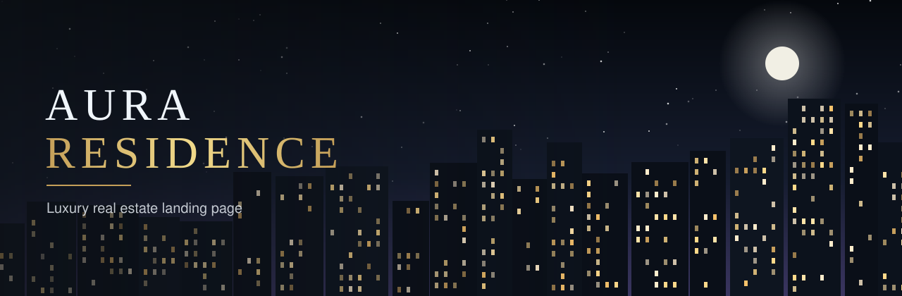

<p align="center">
  
</p>

<p align="center">
  <a href="aura-residence-production.up.railway.app"><b>View live demo →</b></a>
</p>

<p align="center">
  
  
  
  
</p>

---

## About

**AURA RESIDENCE** is a concept landing page for a premium residential complex. The goal is simple: take a visitor from the first impression to a request in a single scroll.

> This is a concept project. The complex, prices, and contacts are fictional.

## Highlights

**A building that changes with the day.** The hero scene is drawn entirely in code. As you scroll, morning turns into sunset and then night: the sun sets, the moon and stars appear, windows light up one by one, lamps turn on in the courtyard, and the facade is reflected in the pond.

| Feature | What it does |
|---|---|
| **Apartment filter** | Switch between 1-, 2-, 3-room apartments and penthouses. Cards show a floor plan, area, floor, and price. |
| **Mortgage calculator** | Four sliders (price, down payment, term, rate) with the monthly payment recalculated live. |
| **Lead form** | Phone mask, validation, preferred call time, and the chosen apartment is filled in automatically. |
| **Infrastructure** | Park, 24/7 concierge, fitness and SPA, kids' club. |
| **Responsive design** | Looks sharp on phones, tablets, and desktops. |
| **Accessible motion** | Heavy effects switch off for users who prefer reduced motion. |

## Design

- Dark palette `#0D1117` / `#161B22` with gold accents `#D4AF37` / `#C5A059`
- Glassmorphism cards with backdrop blur
- Playfair Display for headlines, Inter for body text

## Tech

- HTML5
- Tailwind CSS (via CDN)
- Vanilla JavaScript, no frameworks
- Scene and floor plans are inline SVG, so there are no heavy image files

The whole site is one file: `index.html`.

## Run locally

```bash
git clone https://github.com/Carelesssss/Aura-residence.git
cd Aura-residence
```

Then open `index.html` in any browser. No build step or server is needed (an internet connection is required for fonts and Tailwind).

## Customize

- **Apartments:** edit the `FLATS` array near the end of `index.html`
- **Video:** put an embed link into the `VIDEO_URL` constant
- **Colors and fonts:** change the `tailwind.config` block at the top
- **Contacts and prices:** replace the placeholders in the footer and data

## Author

Made by **Ivan**, web designer and front-end developer. Open to freelance work: landing pages, portfolio sites, and promo pages.

---

<p align="center"><sub>© 2026 AURA RESIDENCE · concept project</sub></p>
